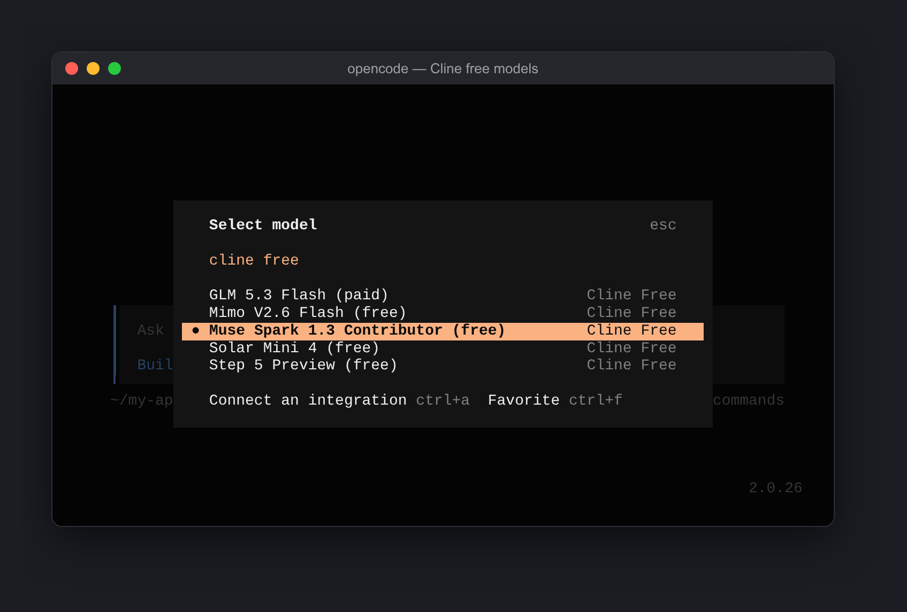
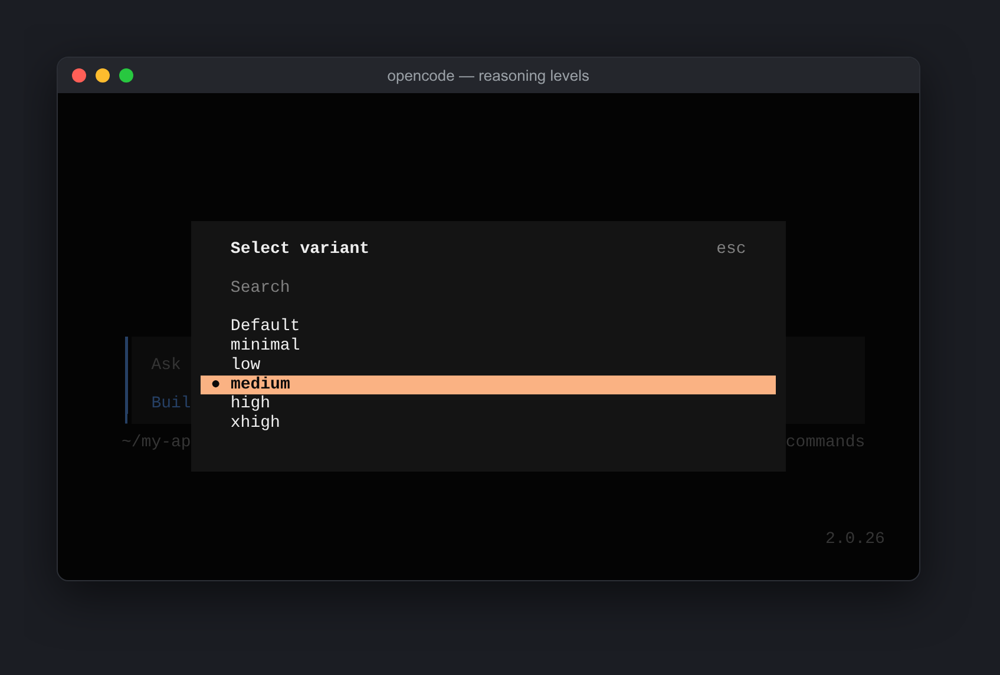
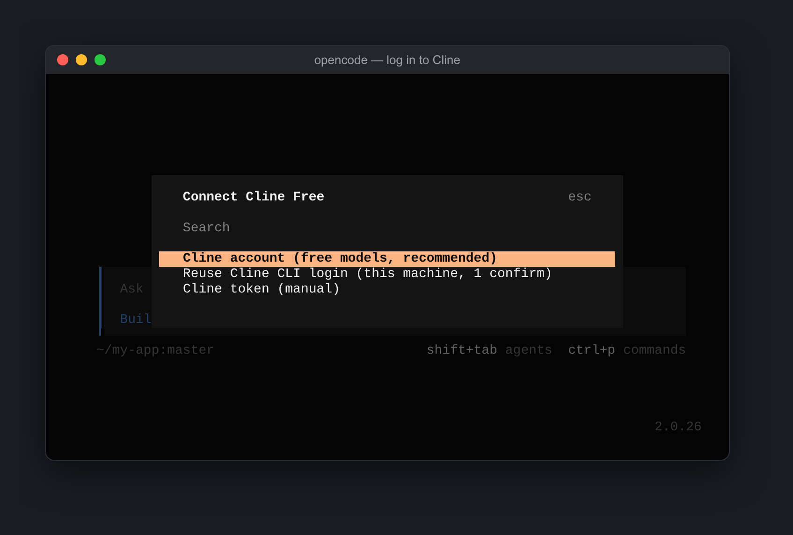
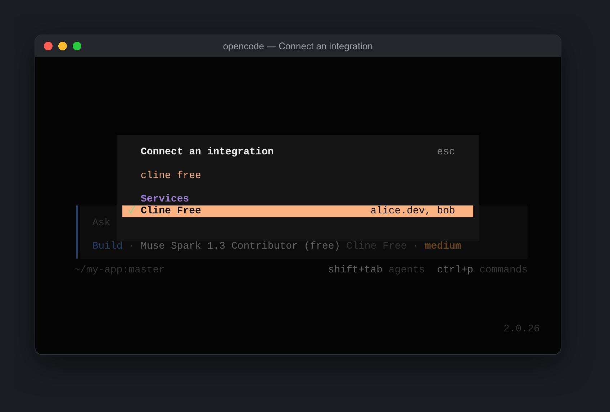
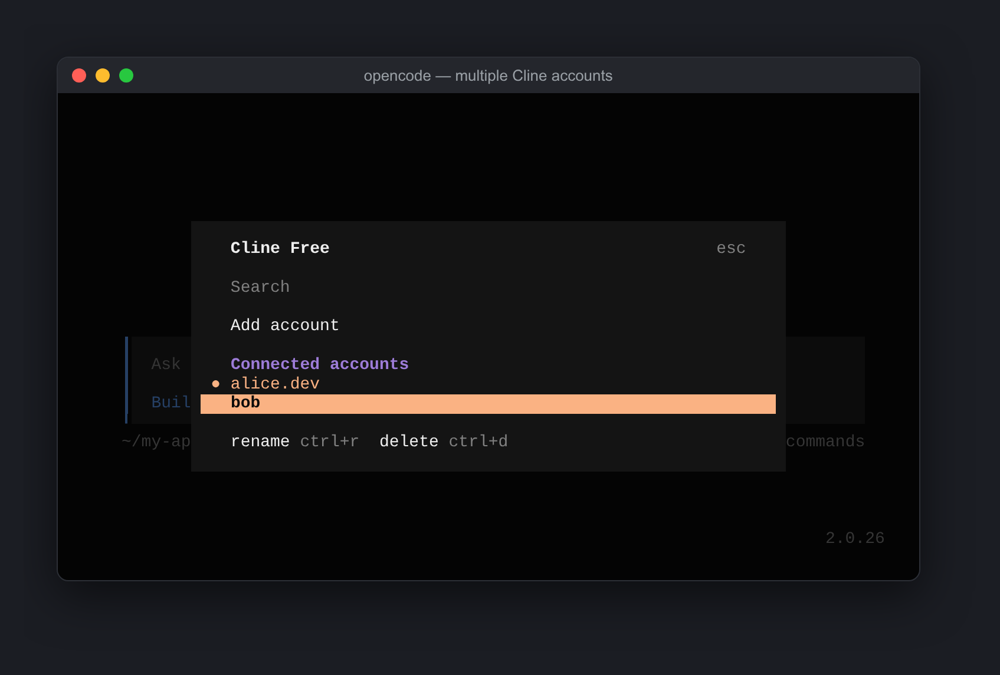
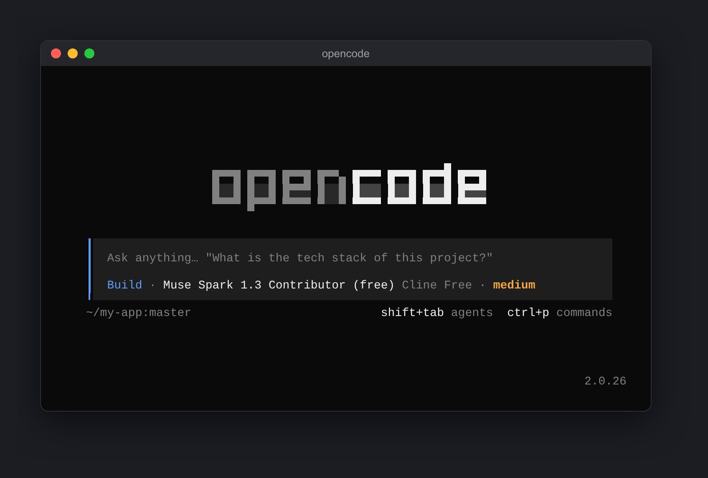

# opencode-cline-free

**v0.8.1** · Use Cline's rotating **free models** inside OpenCode V2 with your Cline account —
same quota you see tagged `FREE` in Cline VSCode/CLI.

> **Requires OpenCode V2 (2.x).** OpenCode 1.x users: stay on 0.6.3, the
> last V1 build (`git checkout 29f68b9`).

Live source: `GET https://api.cline.bot/api/v1/ai/cline/recommended-models`
(`free` array). The plugin fetches it on every startup, so rotations appear
automatically. Offline it falls back to a bundled list.

## Screenshots

<table>
<tr>
<td width="50%" align="center"><br><sub>Cline free models in <code>/models</code></sub></td>
<td width="50%" align="center"><br><sub>Reasoning effort via <code>/variants</code></sub></td>
</tr>
<tr>
<td width="50%" align="center"><br><sub>Three login methods</sub></td>
<td width="50%" align="center"><br><sub>Connected accounts in the Connect dialog</sub></td>
</tr>
<tr>
<td width="50%" align="center"><br><sub>Add, rename or delete accounts</sub></td>
<td width="50%" align="center"><br><sub>Ready to chat with a free model</sub></td>
</tr>
</table>

## Current free rotation (checked 2026-10-11)

| Model id | Notes |
|---|---|
| `cline-free/step-5-preview` | Cline-only free (added 2026-10-11), StepFun Step 5 Preview (sparse MoE, 1M context) · low, medium, high (not probe-verified) |
| `cline-free/solar-mini4` | Cline-only free (added 2026-10-11), Upstage Solar Mini 4 (35B MoE, 524K context) · low, medium, high (not probe-verified) |
| `cline-free/mimo-v2.6-flash` | Cline-only free, MiMo 2.6 (309B MoE) · `none` (reasoning off), `high` (reasoning on) — on/off only |
| `cline-free/muse-spark-1.3-contributor` | Cline-only free · minimal, low, medium, high, xhigh (`max` fails server-side) |

Registered even though they are **not** in the live `free` array (and **not free**):

- `z-ai/glm-5.3-flash` · low, high, max · **bills Cline credits** — the account balance drops by `creditsUsed`, whereas the free rotation records 0
- `xiaomi/mimo-v2.6-pro` · `none` (reasoning off), `high` (reasoning on) · 1M context, 131K output, text/image/video/audio · **bills Cline credits** ($0.435 / $0.87 per 1M tokens)
- `openai/gpt-6.1-sol` · low, medium (default), high, xhigh, max (per OpenAI docs; `none`/`minimal` unsupported) · 1.05M context, 128K output, text/image/PDF · **bills Cline credits** ($2 / $10 per 1M tokens)

Rotated out of the free list (ids kept in the plugin as known/stale where useful):

- `stealth/space-bunny-alpha` (rotated out 2026-10-06)
- `cline-free/deepseek-v4.1-flash` (rotated out 2026-10-05; Cline now lists DeepSeek V4.1 Flash at paid rates)
- `stealth/pixel-canary`, `cline-free/gemini-3.8-flash` (rotated out 2026-10-04)
- `stealth/union-alpha` → replaced by `stealth/space-bunny-alpha`
- `cline-free/solar-pro4`, `poolside/laguna-s-2.1:free`
- `deepseek/deepseek-v4-flash`

### Automatic model discovery

You do not need to edit the plugin when Cline rotates its free models:

- **Which models:** read live from Cline's free list on every start.
- **Their settings:** context/output limits, input types and price are filled
  in automatically from Cline's public model catalog, so a brand-new free
  model works without a code change.
- **Saved copy:** the last good list + settings are kept in
  `cline-free-models.json` (next to the accounts file) so startup is instant
  and works offline; a fresh copy is fetched in the background.

The hand-written entries in `src/models.ts` only pin details the catalog can't
report (probe-verified reasoning levels) and provide the offline fallback.
After a rotation, restart OpenCode (a second restart picks up a background
refresh if the saved copy was older).

## Install

One command (OpenCode V2):

```bash
opencode plugin add github:itsyasirkhandev/opencode-cline-free
```

This installs the plugin and adds it to your global `opencode.json`. Update
later with `opencode plugin update`, remove with `opencode plugin remove`.

### Manual install

```bash
git clone https://github.com/itsyasirkhandev/opencode-cline-free.git
cd opencode-cline-free

# global
mkdir -p ~/.config/opencode/plugins
cp dist/cline-free.js ~/.config/opencode/plugins/cline-free.js

# or project-level
mkdir -p .opencode/plugins
cp dist/cline-free.js .opencode/plugins/cline-free.js
```

Or load the clone directly (V2 only accepts plugin **directories** in config,
not single files):

```json
{ "plugins": ["/path/to/opencode-cline-free"] }
```

Restart OpenCode.

## Login

```text
/connect            (or: opencode auth login)
# pick "cline-free", then one of:
# 1. Cline account (free models, recommended)         <- browser device-code flow
# 2. Reuse Cline CLI login (this machine, 1 confirm)  <- fastest if `cline auth` was run here
# 3. Cline token (manual)                             <- paste a workos:... token
```

Repeat `/connect` → `cline-free` for every extra Cline account: new users
join the rotation pool (re-logging the same user updates it in place).

Each account shows up in OpenCode under a short label (the email part before
`@`, max 12 characters) so the Connect dialog still fits "Cline Free".
Accounts connected with 0.7.1 or older keep their full-email label. Rename
them from the account list (`/connect` → `Cline Free` → select the account →
`ctrl+r`) or log out and log in again.

## Multiple accounts + 429 failover

Free quota is per Cline account and resets daily. The plugin keeps a pool
(`~/.local/share/opencode/cline-free-accounts.json`, override with
`CLINE_FREE_ACCOUNTS_FILE`) and rotates across it:

- **Loader** picks the next healthy account round-robin per request, for
  the request's model: accounts capped on that model are skipped, and for
  paid models so are accounts out of Cline credits.
- **Per-model cooldowns**: Cline's free caps are per user **and** model, so an
  account exhausted on deepseek still has muse quota (and vice versa) and
  stays available as a fallback for the other models.
  `429` bodies like `Try again in 1h 37m` are parsed to match the server.
- **Fetch router**: if Cline answers `429` on a chat request, that account
  is parked until it recovers (`Retry-After` when the server sends one,
  otherwise next UTC midnight for the daily reset) and the **same request
  is retried** on the next account — the turn doesn't fail.
  `401/403` auth rejections (`Unauthorized: ... re-authenticate ...`)
  get the same treatment: the dead account is refreshed once in place and
  replayed, otherwise it is quarantined (`NEEDS-RELOGIN` in
  `cline_free_status`) and the same request is retried on the next healthy
  account. Stale cached tokens are recovered by JWT user key after rotation.
  Only non-auth `403/5xx` pass through untouched so real permission
  problems and outages stay visible.
- **Paid models** (`(paid)` in the model list) fail over the same way on
  `429`, and also on `402 Insufficient balance` (Cline rejects these before
  billing, so nothing is charged twice). The retry spends the **next
  account's** credits. An account that answered `402` is skipped for paid
  models until OpenCode restarts (Cline's starter credits don't refill);
  free models keep using it.
- Cooldowns persist in the pool file, so they survive restarts.

Add accounts three ways (they merge, deduped by stable Cline user identity
— not raw token — so re-login never creates duplicates):

1. `/connect` → `cline-free` repeatedly (device flow / CLI import / manual).
2. Env vars: `CLINE_API_KEY` / `CLINE_FREE_API_KEY`, lists via
   `CLINE_API_KEYS` / `CLINE_FREE_API_KEYS` (comma/space/newline separated),
   or numbered `CLINE_API_KEY_2` … `CLINE_API_KEY_10`
   (same with `CLINE_FREE_` prefix). Env accounts are ephemeral —
   unset the var to drop them.
3. Agent tools: `cline_free_status` (list accounts, active marker,
   cooldowns, `NO-CREDITS` for accounts skipped on paid models), `cline_free_add_token` (validate + add a token),
   `cline_free_remove` (drop a stored account by id).

Already logged into Cline in your browser? Method 1 is then a single
Confirm/Approve click: the login URL has your code pre-filled, so with an
active Cline browser session there's no password and no code to type —
just approve and OpenCode finishes automatically. (A terminal can't read
browser cookies, so that one click is the minimum the OAuth flow allows.)

Skip the browser? If this machine already has a Cline CLI login
(`~/.cline/data/settings/providers.json`, honors `CLINE_DATA_DIR`/`CLINE_DIR`),
method 2 imports its OAuth tokens directly — the account email is shown,
you just confirm, no browser code. Expired tokens are refreshed automatically.

Manual alternative: `/connect` → `cline-free` → `Cline token (manual)` and
paste a `workos:...` token (OpenCode V2 has no hook to validate a pasted key
at connect time; a bad token shows up on the first request — the
`cline_free_add_token` tool validates before saving), or set:

```bash
export CLINE_API_KEY="workos:..."
# extra accounts for rotation:
export CLINE_API_KEY_2="workos:..."
export CLINE_FREE_API_KEYS="workos:...,workos:..."
```

## Use

```text
/models
# pick cline-free / <model>
```

or in `opencode.json`:

```json
{
  "$schema": "https://opencode.ai/config.json",
  "model": "cline-free/cline-free/mimo-v2.6-flash"
}
```

> Note: model ids contain a `/` themselves (e.g. `cline-free/mimo-v2.6-flash`),
> so the full spec is `cline-free/cline-free/mimo-v2.6-flash`.
> `cline-free/...` ids are Cline-native free ids; stealth ids ride the same
> free quota at $0.
> Stale ids (`deepseek/deepseek-v4-flash`, `z-ai/glm-5.3-flash`, etc.) may
> still be in an old config after Cline rotates them out.

See `opencode.example.json` for a minimal config snippet.

## Development

Source lives in `src/` (one file per concern); `dist/cline-free.js` is the
single-file bundle for copy-installs and is committed.

| File | Purpose |
|---|---|
| `src/core/` | runtime-agnostic code (no `@opencode/*` imports) |
| `src/core/models.ts` | one registry with every model's name, status (free/paid/stale), cost, limits, inputs, reasoning efforts |
| `src/core/modelList.ts` | live free list + on-disk cache (`cline-free-models.json`, override `CLINE_FREE_MODELS_FILE`) |
| `src/core/http.ts` / `src/core/auth.ts` | timeouts, retry classification, device-code login, token refresh |
| `src/core/pool.ts` | account pool, rotation, cooldowns, cross-process lock |
| `src/core/router.ts` | provider-scoped fetch with 429/401 failover |
| `src/core/account.ts` | account selection, refresh and fallback (shared by every adapter) |
| `src/core/tools.ts` | tool logic (status / remove / add token) |
| `src/v2.ts` | OpenCode V2 adapter: provider/models, login methods, HTTP hooks, tools (type-only `@opencode/plugin` import) |

```bash
npm ci
npm run typecheck
npm test
npm run bundle  # rebuild dist/ before committing
npm run check   # all three
```

CI (`.github/workflows/ci.yml`) runs these on every push and pull request and
fails if `dist/` is out of date.

> There is deliberately **no `build` script**: for git installs
> (`opencode plugin add github:...`) npm runs a nested `npm install` "prepare"
> step on any package with a `build`/`prepare`/`install`-type script, and that
> step fails inside OpenCode (`git dep preparation failed`). The committed
> `dist/` and TypeScript sources need no build at install time.

## Publish to npm (optional)

Not published yet. When ready:

```bash
npm publish --access public
# then in opencode.json: { "plugins": ["opencode-cline-free"] }
```

## How it works

- `provider.transform` registers provider `cline-free`
  (`@opencode/ai/providers/openai-compatible`,
  `baseURL https://api.cline.bot/api/v1`) plus the live `free` models, each
  with its reasoning efforts as V2 variants. A background refresh of the
  free list calls `provider.reload()` so a rotation fetched after startup
  shows up without a restart.
- `integration.transform` adds the three login methods to the `cline-free`
  integration; logins land in the same account pool file as 0.6.x, so
  existing accounts keep working after the upgrade.
- A provider-scoped `http.request` hook stamps the selected pool account's
  `Authorization: Bearer workos:...`; a scoped `http.response` hook replays
  the same request on the next account on 429/401/403 (the failover that
  used to live in a custom `fetch`).
- **Cline product surface headers** (v0.5.4+): chat requests mirror the
  identity of the Cline VS Code extension v4.1.23 (`User-Agent: Cline/4.1.23`,
  `X-CLIENT-TYPE: VSCode Extension`, `X-CLIENT-VERSION: 4.1.23`,
  `X-CORE-VERSION: 0.0.92`, `X-PLATFORM: Visual Studio Code`,
  `X-PLATFORM-VERSION`, `X-IS-MULTIROOT`, `X-Title: Cline`, plus the session
  id as `X-Task-ID`). The gateway serves native free models
  only to Cline product surfaces; without them it answers
  `403 only available via Cline product surfaces`
  ([cline/cline#13593](https://github.com/cline/cline/issues/13593)).
  Verified 2026-09-21 against the live API.
- The login methods implement Cline's WorkOS device-code OAuth
  (same flow as Pi's `pi-cline` extension) + manual token entry,
  refreshes via `/api/v1/auth/refresh`, and sends
  `Authorization: Bearer workos:...`.
  Refresh is single-flight per account (concurrent requests share one
  refresh so rotation is never mistaken for token replay), transient
  failures retry with backoff while `invalid_grant` quarantines the
  account for re-login (visible as `NEEDS-RELOGIN` in
  `cline_free_status`), pool writes are atomic, and every
  token-endpoint call has a timeout.
- Free quota is per Cline account and rotating/limited — when Cline rotates,
  restart OpenCode to refresh the list.

## Changelog (high level)

| Version | Changes |
|---|---|
| **0.8.1** | Account picks are per model: an account capped on one model still serves the others, the first pick for a paid model skips $0-balance accounts, and `cline_free_status` flags them `NO-CREDITS` |
| **0.8.0** | Paid models now switch accounts on `429` and on `402 Insufficient balance`; a $0-balance account is skipped for paid models until OpenCode restarts (free models unaffected) |
| **0.7.5** | `openai/gpt-6.1-sol` efforts corrected to low, medium, high, xhigh, max (from OpenAI docs) |
| **0.7.4** | Register paid `openai/gpt-6.1-sol` (GPT-6.1 Sol, bills Cline credits) with catalog limits/pricing |
| **0.7.3** | Register paid `xiaomi/mimo-v2.6-pro` (MiMo V2.6 Pro, bills Cline credits) with catalog limits/pricing and on/off reasoning |
| **0.7.2** | Short account labels (email part before `@`, max 12 chars) so "Cline Free" is no longer cut off in OpenCode's Connect dialog when several accounts are logged in |
| **0.7.1** | One-command install: `opencode plugin add github:itsyasirkhandev/opencode-cline-free` now works (the `build` script, renamed to `bundle`, made npm's git-dep "prepare" step fail with `git dep preparation failed`) |
| **0.7.0** | Runs on **OpenCode V2** (`@opencode/plugin` 2.x): models, login methods, 429/401 failover and the 3 tools ported to the V2 API. **V1 support dropped** — OpenCode 1.x users stay on 0.6.3. Config key is now `plugins`. Free rotation sync (2026-10-11): `cline-free/step-5-preview` and `cline-free/solar-mini4` added to the offline fallback |
| **0.6.2** | Sync free rotation (2026-10-06): `stealth/space-bunny-alpha` rotated out (free list is now mimo-v2.6-flash + muse-spark-1.3-contributor); MiMo efforts reduced to `none`/`high` since its reasoning is on/off only |
| **0.6.1** | `cline-free/deepseek-v4.1-flash` removed from the free fallback (left the free list 2026-10-05, now paid); new free models get limits, inputs and price automatically from Cline's public model catalog, cached with the list |
| **0.6.3** | Internal refactor: shared code moved to `src/core/`, OpenCode V1 glue isolated in `src/v1.ts` (prep for OpenCode V2 support). No behaviour change |
| **0.6.0** | Split into `src/` modules + bundled `dist/cline-free.js`; single model registry; provider-scoped fetch (no global `fetch` patch); last good model list cached on disk and refreshed in the background; fair per-model rotation; lock heartbeat so slow refreshes are not broken as stale; paid models never fail over/replay on another account; tests, CI and npm scripts |
| **0.5.10** | Sync free rotation (2026-10-04): `stealth/pixel-canary` and `cline-free/gemini-3.8-flash` rotated out; offline fallback now matches the live list (deepseek-v4.1-flash, space-bunny-alpha, mimo-v2.6-flash, muse-spark-1.3-contributor) |
| **0.5.9** | `stealth/pixel-canary` + `cline-free/gemini-3.8-flash` join the free rotation with effort variants, limits, and multimodal input mapped |
| 0.5.8 | Correct: `z-ai/glm-5.3-flash` is **not** free — it bills Cline credits (balance drops by `creditsUsed`). Still auto-registered, now labelled `(paid)` |
| 0.5.7 | Register `z-ai/glm-5.3-flash` (absent from the live `free` array). Free status was wrong — corrected in 0.5.8 |
| 0.5.6 | Match per-model reasoning variants to the exact set the Cline gateway accepts (live-probed: added `xhigh`/`minimal`/`none` where accepted, dropped nothing valid) |
| 0.5.5 | Refresh bundled free list + metadata for the 2026-09-24 rotation (space-bunny-alpha, mimo-v2.6-flash) |
| 0.5.4 | Send Cline product surface headers — fixes `403 only available via Cline product surfaces` on native free models |
| 0.5.x | `stealth/union-alpha` in free rotation + reasoning variants (low/medium/high/xhigh, medium default) |
| — | Per-model 429 cooldowns; API-key accounts kept separate from OAuth |
| — | Transparent 401/403 auth recovery (refresh + failover); stale cached token recovery by JWT user key |
| — | Production-grade OAuth: single-flight refresh, error classification, quarantine, atomic pool writes |
| — | Multi-account pool with automatic 429 failover; same-user logins deduped by stable Cline identity |
| — | Live free-model list, per-model reasoning variants, vendor-correct limits/cost display ($0) |

## Caveats

- Cline docs say free models are officially for IDE Extension/CLI. This
  plugin reuses the same account API + OAuth the community Pi extensions
  use, and **impersonates the official client surface headers** so the
  gateway accepts native free ids. If Cline still returns `403`, re-login
  (`/connect`) and check your free quota in the Cline dashboard.
- The WorkOS client id is Cline's public OAuth client (same as Pi extension).
- Free list rotates without notice — trust the live endpoint over any
  table in this README.
